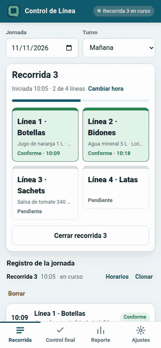

# Control de Línea

App para registrar las **recorridas de control** en las líneas de envasado y el **control
final** de lotes, y sacar al final del turno un **reporte del día** gráfico, listo para
gerencia. Pensada para usarse en planta, con una mano y guantes, y aunque no haya señal.

**[Abrir la app](https://roca-byte.github.io/controlLinea/)** · **[Video (1:13)](docs/video/control-linea-demo.mp4)** · **[Guía de uso con capturas](docs/GUIA.md)**

## Para qué sirve

Deja evidencia de que **cada línea fue controlada**, recorrida por recorrida, haya habido
desvíos o no. En lugar de una planilla en papel que después se pasa en limpio, cada control
se marca en el momento con un toque, y el reporte se arma solo.

## Qué podés hacer

- **Recorridas** (R1, R2, R3…): la app te lleva línea por línea, en el orden de tu planta.
  En cada una marcás:
  - **Conforme**
  - **Ajuste en línea**: anotás qué se detectó o corrigió y, si querés, la magnitud
    (litros, kilos, unidades, minutos…).
  - **Sin producción**
- **Control final** de cada lote terminado antes del despacho: **Conforme**, **Parcial**
  (algunos pallets no están bien, con la cantidad), **Reprocesado** o **No conforme**.
- **Corregir después**: cambiar horarios, agregar una línea que quedó sin cargar en una
  recorrida cerrada, y clonar o renumerar recorridas.
- **Reporte del día**, pensado para leerse en segundos (más gráfico que texto):
  - **Exportar a PDF** en hoja A4.
  - **Compartir un resumen** como texto (WhatsApp, mail).
  - Elegir si el reporte incluye o no el control final.
- **Adaptarla a tu planta**: nombre y logo de la empresa, tus líneas en el orden en que las
  recorrés, turnos y unidades (pestaña **Ajustes**).

## Cómo se usa

1. **Ajustes**: cargá el nombre de la empresa, el logo (opcional) y las líneas en el orden en
   que las recorrés.
2. **Recorrida**: tocá *Iniciar recorrida*. La app te lleva línea por línea; marcá Conforme,
   Ajuste en línea o Sin producción. Si hubo un ajuste, completá qué pasó.
3. **Control final**: registrá cada lote terminado antes del despacho.
4. **Reporte**: elegí la jornada y tocá *Exportar PDF* o *Compartir resumen*.

Paso a paso, con capturas: [docs/GUIA.md](docs/GUIA.md).

## Instalarla en el celular

1. Abrí el link de la app.
2. **Android (Chrome):** menú ⋮ → *Instalar app* (o *Agregar a la pantalla principal*).
   **iPhone (Safari):** botón Compartir → *Agregar a inicio*.
3. Listo: queda como una app más y, después de abrirla una vez, funciona sin señal.

## Tus datos

- Todo lo que cargás queda **solo en tu dispositivo**. No hay cuentas ni servidor.
- Si borrás los datos del navegador o cambiás de celular, se pierden. En **Ajustes** podés
  **descargar un respaldo** y después **restaurarlo**. Hacelo cada tanto.

## Licencia

Libre para usar, copiar y modificar ([MIT](LICENSE)). © 2026 Maximiliano Roca.

---

Parte de la suite [**QualityOS**](https://github.com/roca-byte) · Información técnica para
modificarla: [DESARROLLO.md](DESARROLLO.md)
