# Guía de uso — Control de Línea

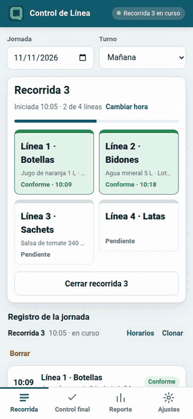

Paso a paso para usar la app en planta. **¿Preferís verla andando?** Mirá el
[video de 1 minuto](video/control-linea-demo.mp4).

> Las capturas usan datos inventados: "Envasadora Demo S.A.", productos y lotes de ejemplo.

## Índice

1. [Ajustes: tus líneas y tu empresa](#1-ajustes-tus-líneas-y-tu-empresa)
2. [Recorrida: línea por línea](#2-recorrida-línea-por-línea)
3. [Corregir después](#3-corregir-después)
4. [Control final](#4-control-final)
5. [Reporte del día](#5-reporte-del-día)
6. [Preguntas frecuentes](#6-preguntas-frecuentes)

---

## 1. Ajustes: tus líneas y tu empresa

Se hace una sola vez. Entrá a la pestaña **Ajustes**:

- **Nombre del checker**: aparece en el reporte.
- **Líneas de la planta**: una por renglón, **en el orden en que las recorrés**. La app te va
  a llevar en ese orden.
- **Unidades para la relevancia** (L, kg, unid., min…) y **Turnos**: una por renglón.

Tocá **Guardar ajustes**.

Más abajo, en **Empresa**, escribí el nombre de la empresa: va en el encabezado del reporte
(se guarda solo, mientras escribís). Si cargás un **logo**, el reporte muestra el logo en
lugar del nombre.

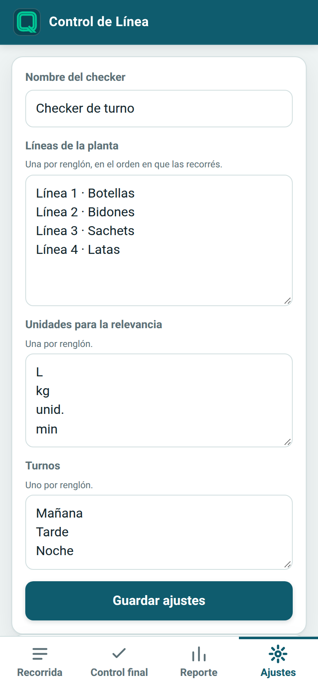
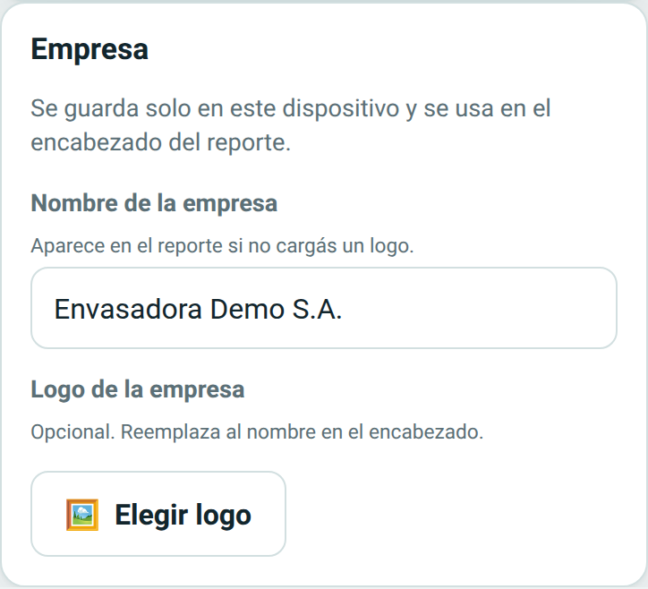

## 2. Recorrida: línea por línea

Cada vuelta completa por las líneas es una **recorrida** (R1, R2, R3…).

1. En la pestaña **Recorrida**, revisá la **Jornada** (la fecha) y elegí el **Turno**.
2. Tocá **Iniciar recorrida**. Se abre la primera línea.

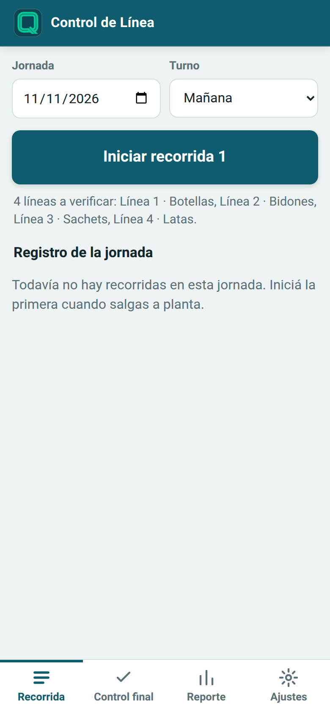

3. Revisá **producto** y **lote** (desde la segunda vuelta vienen cargados de la anterior),
   la **hora** (la del momento; la podés cambiar) y marcá el **resultado**:
   - **Conforme**
   - **Ajuste en línea**
   - **Sin producción** (no pide lote)
4. Tocá **Guardar y seguir**: se abre sola la línea siguiente que falta.

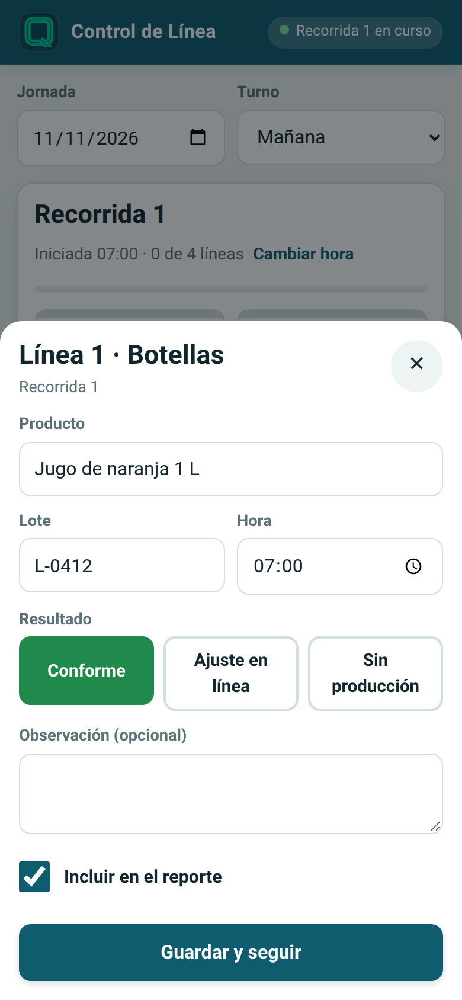

### Si hubo un ajuste en línea

Marcá **Ajuste en línea** y completá:

- **¿Qué se detectó y qué se ajustó?** (obligatorio).
- **Relevancia del evento**: qué se evitó o corrigió y, si querés, la **magnitud** con su
  unidad (por ejemplo 120 L o 15 min). En el reporte las magnitudes se suman por unidad.

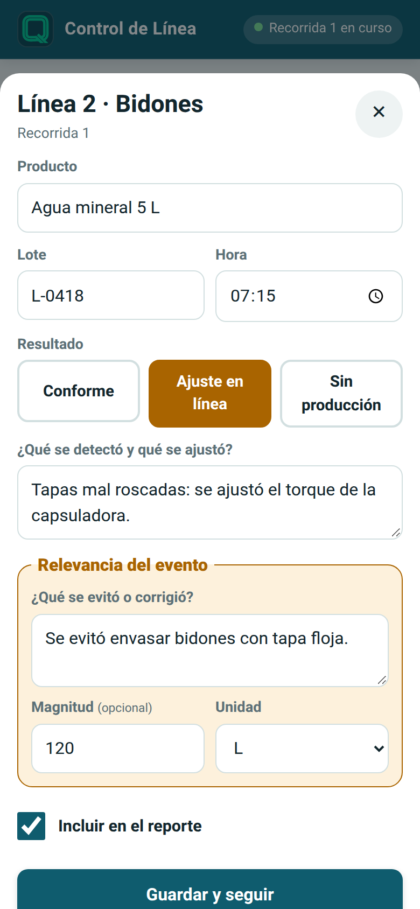

### Mientras la recorrida está abierta

Arriba ves cuántas líneas llevás, y cada línea con su resultado y hora. Tocá cualquier línea
para cargarla fuera de orden. Si tocás una que **ya controlaste** en esta recorrida, la app
te pregunta si **empezás la recorrida siguiente** con esa línea o si **corregís** el control.

Cuando terminás, tocá **Cerrar recorrida**. Si quedaron líneas sin verificar, te avisa
antes de cerrar.

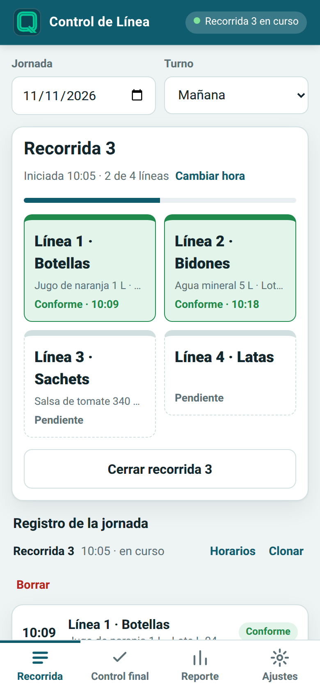

Cada control tiene la casilla **Incluir en el reporte**: si la destildás, ese control queda
guardado pero el reporte no lo cuenta.

## 3. Corregir después

Abajo de la pestaña **Recorrida** está el **Registro de la jornada**, agrupado por recorrida.
Desde ahí:

- **Tocá un control** para corregirlo (incluida la hora) o eliminarlo.
- **Horarios**: corregí el inicio y el fin de la recorrida, o su número (las demás se
  renumeran solas). El reporte usa estos horarios.
- **+ Línea**: en una recorrida cerrada, las líneas que quedaron sin cargar aparecen como
  botones. Al tocar una, la hora sugerida es la del inicio de esa recorrida: poné la hora
  real en que la controlaste.
- **Clonar**: copia una recorrida (para cubrir una que te olvidaste de registrar). La copia
  no repite los ajustes: quedan como Conforme, para corregir.
- **Reabrir** una recorrida cerrada, o **Borrar** una recorrida con sus controles.

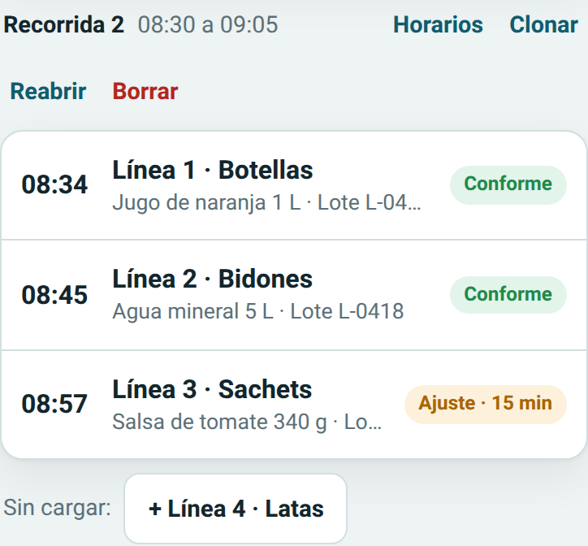

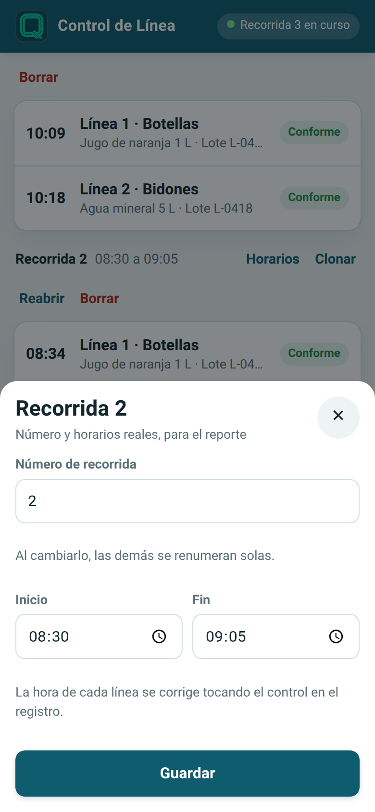
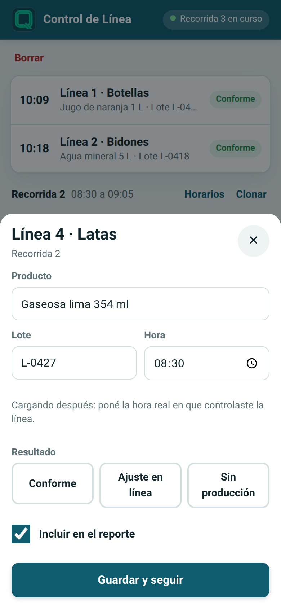

## 4. Control final

En la pestaña **Control final** registrás cada lote terminado antes del despacho. Tocá
**Registrar lote en control final**, elegí la **línea de origen**, cargá producto, lote y
hora, y el resultado:

| Resultado | Cuándo | Qué pide |
|---|---|---|
| **Conforme** | El lote está bien. | — |
| **Parcial** | Algunos pallets no están OK. | Cantidad de pallets no OK y cuáles/por qué. |
| **Reprocesado** | Tenía una falla y la corregiste antes del despacho. | Qué falla tenía y cómo la corregiste. |
| **No conforme** | El lote no cumple. | Qué no cumple. |

En Parcial, Reprocesado y No conforme también podés cargar la relevancia del evento.

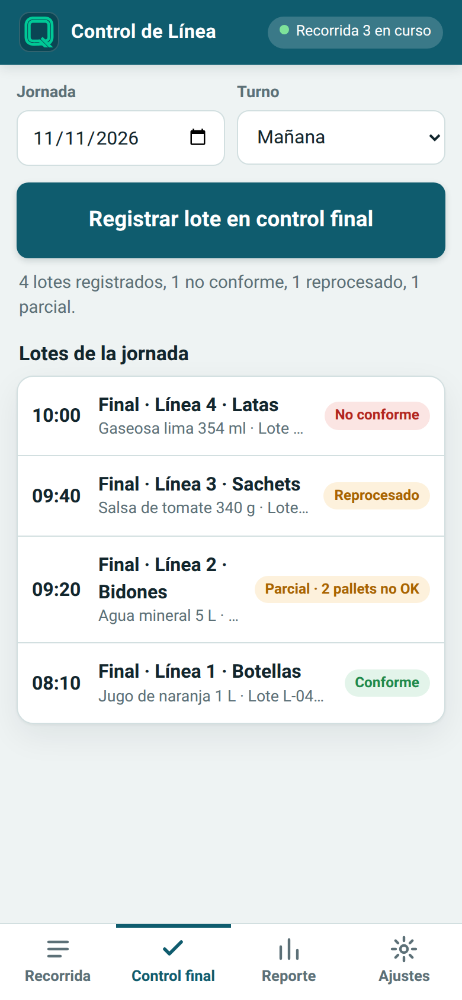
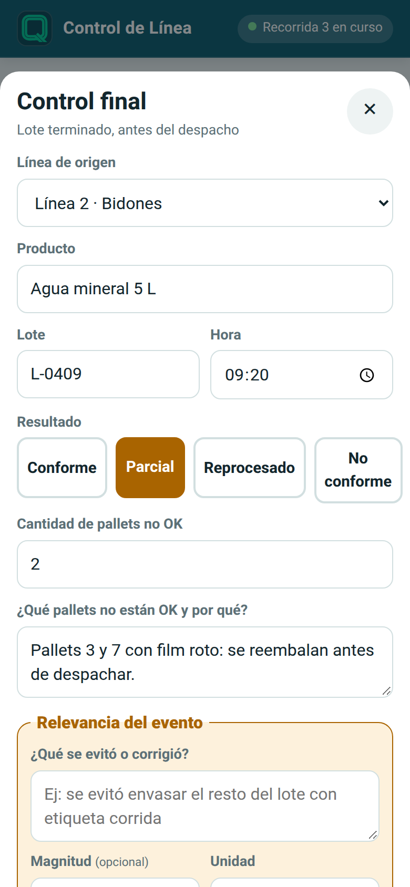

## 5. Reporte del día

En la pestaña **Reporte** elegí la **jornada**. El reporte se arma solo con lo que cargaste:

- Cantidad de controles, recorridas, lotes distintos, ajustes en línea, lotes en control
  final, la **magnitud de los eventos** y el porcentaje de **conformes al primer control**.
- **Cobertura de la recorrida**: qué línea se verificó en cada recorrida (y cuáles no).
- **Actividad por hora**, **Eventos relevantes** y la tabla de **Control final**.

Con la casilla **Incluir Control final en este reporte** decidís si esa jornada lo muestra
(los datos no se borran).

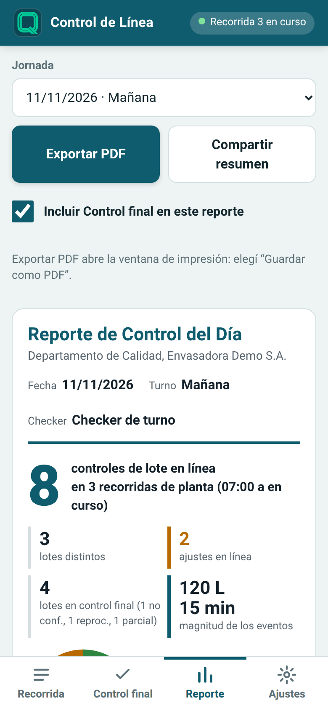
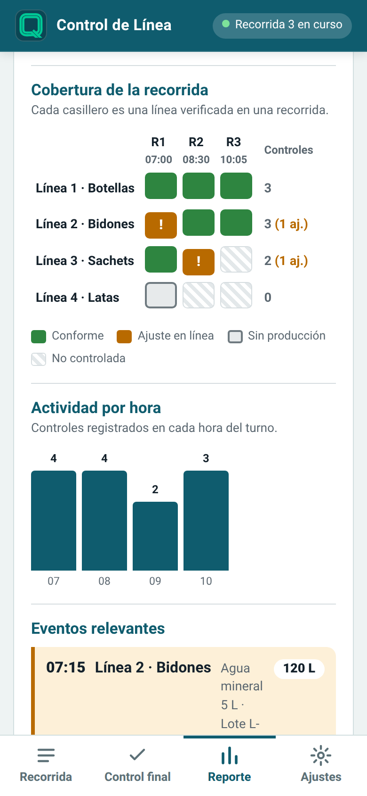

### Exportar PDF

Tocá **Exportar PDF**: se abre la ventana de impresión; elegí **Guardar como PDF**. Sale en
hoja A4:

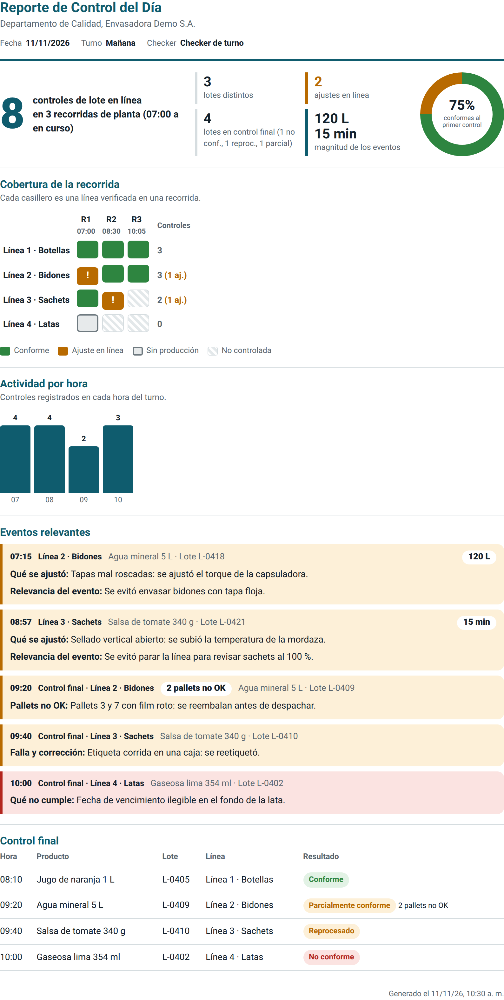

### Compartir resumen

Tocá **Compartir resumen**: en el celular se abre el menú de compartir (WhatsApp, mail…);
en la compu, el resumen se copia para pegarlo donde quieras. Es un texto corto con los
números del día y cada evento:

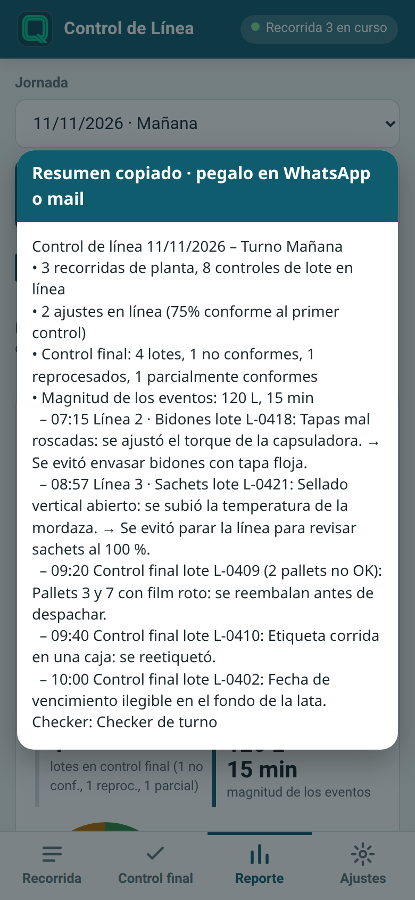

> Para corregir el reporte o el PDF, corregí los datos (sección 3): el reporte siempre se
> arma con lo que está cargado.

## 6. Preguntas frecuentes

**¿Funciona sin señal?** Sí. Después de abrirla una vez con internet, funciona sin señal.

**¿Dónde quedan mis datos?** Solo en tu dispositivo: no hay cuentas ni servidor. Si borrás
los datos del navegador o cambiás de celular, se pierden.

**¿Cómo hago un respaldo?** En **Ajustes → Respaldo**: **Descargar respaldo** baja un archivo
con todo; **Restaurar respaldo** lo vuelve a cargar (reemplaza los datos actuales). Hacelo
cada tanto.

**Me quedó una recorrida abierta de ayer (turno noche).** Al abrir la app, arranca en esa
jornada para que la termines. Para ver otro día, cambiá la fecha en **Jornada**.

**¿Cómo la instalo en el celular?** Ver [Instalarla en el celular](../README.md#instalarla-en-el-celular).
